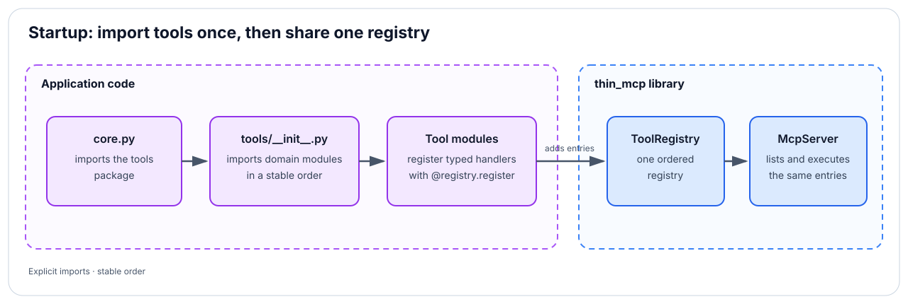

# Using thin-mcp in a Django application

This guide shows the recommended production shape for a Django application.
The important design choice is that `thin-mcp` is a dependency of a host-owned
integration package; it is not a Django app that discovers or owns your domain
logic.

For a FastAPI host, use the separate [FastAPI example](docs/fastapi.md).
For a minimal runnable Django host with the same module structure, see the
[Django Ninja example](docs/django-ninja.md).


## 1. Keep three responsibilities separate

The integration has three layers:

- **`thin_mcp`** validates protocol messages, owns the typed registry, and
  dispatches requests.
- **Your `mcp_server/` package** owns the endpoint, authentication, global
  capability checks, auditing, throttling, registration, and tool adapters.
- **Your Django domain apps** own models, services, queries, and business rules.

A tool handler should be a thin typed adapter. It validates MCP-shaped input,
uses permissions to resolve authorized objects, calls the domain service, and
maps the result into a Pydantic output model. It should not duplicate the
domain operation or call another HTTP endpoint inside the same process.

## 2. Install the Django integration extra

```bash
uv add "thin-mcp[django]>=0.1.0,<0.2.0"
```

For local development against a sibling checkout:

```toml
[project]
dependencies = [
    "thin-mcp[django]>=0.1.0,<0.2.0",
]

[tool.uv.sources]
thin-mcp = { path = "../thin-mcp", editable = true }
```

Remove the source override after publishing and use a pinned compatible release
from your package index.

## 3. Add one host integration package

Create a normal Python package in the Django project. It does not need Django
models unless your product stores MCP credentials or audit records.

```text
my_project/
├── config/
│   └── urls.py
├── accounts/
│   ├── models.py
│   └── services.py
├── projects/
│   ├── models.py
│   └── services.py
└── mcp_server/
    ├── __init__.py
    ├── api.py                 HTTP, auth, throttle, audit
    ├── core.py                configured McpServer and host policy
    ├── permissions.py         object-level authorization
    ├── schemas.py             shared MCP-facing Pydantic models
    ├── tools_registry.py      one registry and registration decorator
    └── tools/
        ├── __init__.py        explicit, ordered domain imports
        ├── accounts.py        account tool adapters
        └── projects.py        project tool adapters
```

Use one module per domain, not one file per tool. A domain module can expose a
small related set such as `list_projects`, `get_project`, and `create_project`.

## 4. Own one registry and registration decorator

The simplest host can expose `ToolRegistry.register` directly. Most production
applications also need every tool to declare a host-specific capability. Wrap
registration once so that declaration cannot be forgotten.

```python
# mcp_server/tools_registry.py
from collections.abc import Callable
from enum import StrEnum

from pydantic import BaseModel

from thin_mcp import (
    ToolAnnotations,
    ToolContext,
    ToolPermission,
    ToolRegistry,
)

tool_registry = ToolRegistry()


class ToolAccess(StrEnum):
    READ = "read"
    WRITE = "write"
    DELETE = "delete"


tool_access: dict[str, ToolAccess] = {}


def register_tool[ArgumentsT: BaseModel, ResultT: BaseModel](
    *,
    name: str,
    description: str,
    arguments_model: type[ArgumentsT],
    result_model: type[ResultT],
    access: ToolAccess,
    permissions: tuple[ToolPermission, ...] = (),
    invalid_arguments_message: str = "Invalid tool arguments.",
    annotations: ToolAnnotations | None = None,
) -> Callable[
    [Callable[[ToolContext, ArgumentsT], ResultT]],
    Callable[[ToolContext, ArgumentsT], ResultT],
]:
    register = tool_registry.register(
        name=name,
        description=description,
        arguments_model=arguments_model,
        result_model=result_model,
        permissions=permissions,
        invalid_arguments_message=invalid_arguments_message,
        annotations=annotations,
    )

    def decorator(
        handler: Callable[[ToolContext, ArgumentsT], ResultT],
    ) -> Callable[[ToolContext, ArgumentsT], ResultT]:
        registered_handler = register(handler)
        tool_access[name] = access
        return registered_handler

    return decorator
```

This wrapper is host code. `ToolAccess`, token capabilities, and their policy do
not belong in `thin_mcp` because every application has different security
semantics.

## 5. Put object authorization in ordered permissions

Permissions can validate access and retain the authorized resource for the
handler. This avoids querying once for authorization and again for execution.

```python
# mcp_server/permissions.py
from pydantic import BaseModel

from projects.models import Project
from projects.services import find_project_for_user
from thin_mcp import ToolContext, ToolPermissionDenied

from mcp_server.schemas import ProjectArguments


class ProjectMemberPermission:
    def check(self, context: ToolContext, arguments: BaseModel) -> None:
        if not isinstance(arguments, ProjectArguments):
            raise TypeError("ProjectMemberPermission requires project_id.")

        project = find_project_for_user(
            user=context.user,
            project_id=arguments.project_id,
        )
        if project is None:
            raise ToolPermissionDenied("You do not have access to this project.")

        context.set_resource(project)
```

For nested authorization, register permissions in dependency order. A company
permission can resolve a membership first, followed by a project permission
that requires that membership from `ToolContext`.

## 6. Register tools beside their domain adapters

Define strict argument and result models, accurate MCP annotations, the required
host capability, and ordered object permissions in one declaration.

```python
# mcp_server/schemas.py
from uuid import UUID

from pydantic import BaseModel, ConfigDict


class ProjectArguments(BaseModel):
    model_config = ConfigDict(extra="forbid")

    project_id: UUID


class ProjectResult(BaseModel):
    id: UUID
    name: str
    status: str
```

```python
# mcp_server/tools/projects.py
from projects.models import Project
from projects.services import describe_project
from thin_mcp import ToolAnnotations, ToolContext

from mcp_server.permissions import ProjectMemberPermission
from mcp_server.schemas import ProjectArguments, ProjectResult
from mcp_server.tools_registry import ToolAccess, register_tool

READ_ONLY_TOOL = ToolAnnotations(
    read_only_hint=True,
    destructive_hint=False,
    idempotent_hint=True,
    open_world_hint=False,
)


@register_tool(
    name="get_project",
    description="Return one project visible to the authenticated user.",
    arguments_model=ProjectArguments,
    result_model=ProjectResult,
    access=ToolAccess.READ,
    permissions=(ProjectMemberPermission(),),
    invalid_arguments_message="A valid project_id is required.",
    annotations=READ_ONLY_TOOL,
)
def get_project(
    context: ToolContext,
    arguments: ProjectArguments,
) -> ProjectResult:
    project = context.require_resource(Project)
    description = describe_project(project)
    return ProjectResult(
        id=project.id,
        name=project.name,
        status=description.status,
    )
```

Use `ToolExecutionError` for expected failures that a client can act on. Allow
unexpected exceptions to propagate so the host can log them and return a safe
internal-error envelope.

## Metadata and content results

A registration may provide JSON-compatible `meta`, exposed unchanged as `_meta`
in `tools/list`, and a `content_builder` that receives the request context and
validated result. Its content blocks follow the existing JSON text
fallback; `structuredContent` remains the validated result. The callback runs
once after permissions and validation. Raise `ToolExecutionError` for expected
failures; unexpected exceptions propagate to the host.

```python
from pydantic import BaseModel
from thin_mcp import ImageContent, ToolContext, ToolRegistry


class PreviewArguments(BaseModel):
    label: str


class PreviewResult(BaseModel):
    label: str


def preview_content(context: ToolContext, result: PreviewResult) -> list[ImageContent]:
    # A tiny prepared PNG; real applications load an authorized, bounded preview.
    png = (
        "iVBORw0KGgoAAAANSUhEUgAAAAEAAAABCAQAAAC1HAwCAAAAC0lEQVR42mP8/x8A"
        "AwMCAO+/aXcAAAAASUVORK5CYII="
    )
    return [ImageContent(data=png, mime_type="image/png")]


registry = ToolRegistry()


@registry.register(
    name="preview",
    description="Return a labeled preview.",
    arguments_model=PreviewArguments,
    result_model=PreviewResult,
    meta={"example.org/preview": {"kind": "image"}},
    content_builder=preview_content,
)
def preview(context: ToolContext, arguments: PreviewArguments) -> PreviewResult:
    return PreviewResult(label=arguments.label)
```

Image data is base64-encoded and increases payload size by roughly one third.
The host owns image access checks, preparation, and preview size limits. Test
actual display separately with each target client.

The callback can return `TextContent`, `ImageContent`, `AudioContent`,
`ResourceLink`, and `EmbeddedResource` blocks in any combination. Blocks
support optional `ContentAnnotations` and JSON `_meta`. Embedded resources
contain either `TextResourceContents` or `BlobResourceContents`; binary blobs
and audio data are base64-encoded. Resource links need a URI clients can access.
`thin-mcp` does not implement resource discovery or reads: hosts must provide
those capabilities separately when needed. The MCP specification recommends
that servers using embedded resources implement the resources capability.

## 7. Import domain modules explicitly

Registration happens when the domain module is imported. Make that side effect
explicit and deterministic in `tools/__init__.py`:

```python
# mcp_server/tools/__init__.py
# ruff: noqa: I001

from mcp_server.tools_registry import tool_registry

# Import order is the stable tools/list order.
from mcp_server.tools import accounts, projects

registered_tool_domains = (accounts, projects)

__all__ = ("tool_registry",)
```

Then import `tool_registry` through `mcp_server.tools`, not directly from
`tools_registry`, when constructing the server. That import guarantees the
domain modules have registered their tools first.



This explicit registration pattern is preferred over Django `AppConfig.ready`,
filesystem scanning, or decorator auto-discovery. It is easy to inspect, test,
and keep stable across deployments.

## 8. Configure the protocol core

`core.py` applies host-wide policy around the framework dispatcher. The exact
credential model and capability checks are application-specific.

```python
# mcp_server/core.py
from pydantic import ValidationError

from thin_mcp import (
    McpHttpResult,
    McpRequest,
    McpRequestHeaders,
    McpServer,
    ToolCallParams,
)
from thin_mcp.tools import tool_error_result

from mcp_server.models import McpCredential
from mcp_server.tools import tool_registry
from mcp_server.tools_registry import tool_access

PROTOCOL_VERSIONS = ("2025-06-18", "2025-11-25", "2026-07-28")

server = McpServer(
    name="my-product",
    version="1.0.0",
    protocol_versions=PROTOCOL_VERSIONS,
    tools=tool_registry,
)


def authorize_tool_call(
    credential: McpCredential,
    request: McpRequest,
) -> McpHttpResult | None:
    if request.method != "tools/call" or request.is_notification:
        return None

    try:
        call = ToolCallParams.model_validate(request.params)
    except ValidationError:
        return None  # The dispatcher returns the protocol validation error.

    tool = tool_registry.get(call.name)
    if tool is None:
        return None  # The dispatcher returns the unknown-tool error.

    required_access = tool_access.get(call.name)
    if required_access is None:
        raise RuntimeError(f"MCP tool {call.name} has no access policy.")
    if credential.allows(required_access):
        return None

    return McpHttpResult.success(
        request.id,
        tool_error_result("This credential cannot use that tool."),
    )


def process_request(
    credential: McpCredential,
    request: McpRequest,
    headers: McpRequestHeaders,
) -> McpHttpResult:
    protocol_error = server.validate_http_request(request, headers)
    if protocol_error is not None:
        return protocol_error

    denied = authorize_tool_call(credential, request)
    if denied is not None:
        return server.format_result(request, denied)

    return server.dispatch_request(
        credential.user,
        request,
        resources=(credential,),
    )
```

Passing the authenticated credential in `resources` makes it available to a
tool permission or handler with `context.require_resource(McpCredential)`.

## 9. Add the Django Ninja endpoint

The endpoint owns the transport boundary. Authentication and throttling shown
below are placeholders for the host application's implementations.

```python
# mcp_server/api.py
import logging

from django.http import HttpRequest, HttpResponse

from thin_mcp import JsonRpcErrorCode, McpHttpResult, McpRequest, McpRequestHeaders
from thin_mcp.django_ninja import McpAPI, render_mcp_result

from mcp_server.auth import McpBearerAuth
from mcp_server.core import process_request
from mcp_server.models import McpCredential
from mcp_server.throttle import McpThrottle

logger = logging.getLogger(__name__)

api = McpAPI(
    title="My product MCP",
    version="1.0.0",
    urls_namespace="mcp-api",
    docs_url=None,
    openapi_url=None,
)


@api.post("", auth=McpBearerAuth(), throttle=McpThrottle(), response=None)
def mcp_endpoint(request: HttpRequest, payload: McpRequest) -> HttpResponse:
    credential = request.auth
    if not isinstance(credential, McpCredential):
        return HttpResponse(status=401)

    try:
        result = process_request(
            credential,
            payload,
            McpRequestHeaders.from_mapping(request.headers),
        )
    except Exception:
        logger.exception("Unhandled MCP request error")
        result = (
            McpHttpResult.accepted()
            if payload.is_notification
            else McpHttpResult.error(
                payload.id,
                JsonRpcErrorCode.INTERNAL_ERROR,
                "Internal error.",
                status=500,
            )
        )
    return render_mcp_result(result)
```

Mount the API through the Django URL configuration:

```python
# config/urls.py
from django.urls import path

from mcp_server.api import api as mcp_api

urlpatterns = [
    path("api/mcp", mcp_api.urls),
]
```

The host should also apply its normal HTTPS, request-size, timeout, CORS/origin,
logging, secret-redaction, and abuse controls at this boundary.

## 10. Test the integration at three levels

Test each layer where it owns behavior:

1. **Tool adapter tests:** argument validation, result shape, expected errors,
   ordered permissions, and authorized resources.
2. **Registry/core tests:** duplicate names, stable `tools/list` ordering, every
   registered tool having required host metadata, capability denial, protocol
   negotiation, and dispatch.
3. **Endpoint tests:** authentication, headers, throttling, malformed JSON,
   safe internal errors, audit behavior, and exact response serialization.

A useful startup invariant for a custom registration wrapper is:

```python
def test_every_tool_declares_host_access() -> None:
    assert set(tool_access) == {tool.name for tool in tool_registry.all()}
```

Keep domain business logic covered by its owning application's tests rather
than retesting it through every MCP adapter.

## 11. Migrate an existing in-repository copy

For a safe first extraction:

1. Add `thin-mcp[django]` as an editable sibling path dependency.
2. Keep the host application's `mcp_server/` package and its `tools/` modules in
   the host repository.
3. Remove only the old local `thin_mcp/` framework package.
4. Run framework, MCP integration, permission, and endpoint tests.
5. Build the host application in a clean environment to catch undeclared
   imports.
6. Tag and publish `thin-mcp`, replace the path override with a pinned release,
   and repeat the clean install.

Do not move concrete tools into the library during extraction. Their schemas,
permissions, domain imports, and business behavior belong to the host.

## 12. What to do next

For a new host application:

- create `mcp_server/` and the explicit `tools/` package;
- define one registry and register a read-only identity or health tool first;
- wire `initialize`, `tools/list`, and that tool through the real auth boundary;
- add capability metadata and object permissions before state-changing tools;
- add audit and throttling behavior in the host endpoint;
- pin a `0.x` version until the public API is proven across more than one host.

For this library:

- run the Python 3.12–3.14 CI matrix on every change;
- verify both core-only and `django`-extra installations;
- add protocol features only when a real host needs them;
- document public API changes in `CHANGELOG.md`; and
- publish `1.0.0` only after the integration boundary and compatibility policy
  have been exercised by external consumers.

When deciding where new code belongs, use this rule: reusable MCP protocol and
typed execution behavior belongs in `thin_mcp`; everything that knows what a
user, tenant, project, role, token, or domain operation means belongs in the
host application.
