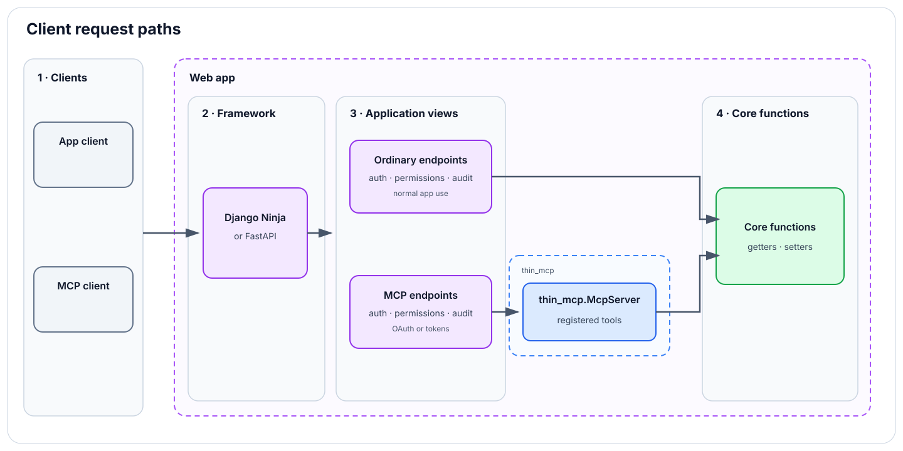

# thin-mcp

`thin-mcp` is a small, typed framework for implementing the tool-serving
surface of the [Model Context Protocol](https://modelcontextprotocol.io/).
It connects strict Pydantic models to an explicit tool registry and a
transport-independent protocol dispatcher.



The package deliberately does not own authentication, application permissions,
throttling, auditing, Django models, or business logic. A Django application
should provide a small integration package—typically named `mcp_server/`—that
registers tools from its application domains and connects the framework to its
HTTP and security layers.

## Why Django Ninja?

Django API projects are often built with Django REST Framework (DRF). For this
project, I wanted Pydantic models to define and validate the MCP-facing data,
so I chose Django Ninja for the optional Django HTTP adapter. The protocol
dispatcher and typed tool registry remain framework-neutral; applications can
also connect them to another framework, such as FastAPI, with a small route
adapter.

> **Status:** `0.x` alpha. The package is suitable for pinned dependencies,
> but its public API may still change between minor releases.

## Installation

Install the core package:

```bash
pip install thin-mcp
```

Install the optional Django Ninja adapter:

```bash
pip install "thin-mcp[django]"
```

Python 3.12 or newer and Pydantic 2.12 or newer are required.

## Recommended Django integration

Keep the MCP integration in the host application, separate from both
`thin_mcp` and the domain applications it exposes:

```text
my_project/
├── accounts/
│   └── services.py
├── projects/
│   └── services.py
└── mcp_server/
    ├── api.py
    ├── core.py
    ├── permissions.py
    ├── schemas.py
    ├── tools_registry.py
    └── tools/
        ├── __init__.py
        ├── accounts.py
        └── projects.py
```

The recommended pattern is registration-driven:

1. `tools_registry.py` owns one `ToolRegistry` and, when needed, a host-specific
   `register_tool` wrapper that requires every tool to declare application
   policy such as token access.
2. Each `tools/<domain>.py` module defines typed adapters for one Django domain.
3. `tools/__init__.py` explicitly imports every domain module in stable order.
   Importing this package populates the shared registry.
4. `core.py` constructs one `McpServer` with that populated registry.
5. `api.py` handles HTTP, authentication, throttling, and auditing, then delegates
   the validated request to `core.py`.

This makes `tools/list` deterministic and ensures the schema advertised for a
tool is the schema enforced when that tool runs. Avoid filesystem auto-discovery
or registration hidden in Django app startup hooks.

See [GUIDE.md](GUIDE.md) for a complete generic Django example, permission
patterns, tests, and migration steps.

## Minimal framework example

```python
from pydantic import BaseModel, ConfigDict

from thin_mcp import McpRequest, McpServer, ToolContext, ToolRegistry


class EchoArguments(BaseModel):
    model_config = ConfigDict(extra="forbid")

    text: str


class EchoResult(BaseModel):
    text: str


registry = ToolRegistry()


@registry.register(
    name="echo",
    description="Echo typed text.",
    arguments_model=EchoArguments,
    result_model=EchoResult,
)
def echo(context: ToolContext, arguments: EchoArguments) -> EchoResult:
    return EchoResult(text=arguments.text)


server = McpServer(
    name="example",
    version="1.0.0",
    protocol_versions=("2025-11-25",),
    tools=registry,
)

request = McpRequest.model_validate(
    {
        "jsonrpc": "2.0",
        "id": 1,
        "method": "tools/call",
        "params": {"name": "echo", "arguments": {"text": "hello"}},
    }
)
response = server.dispatch_request(user=None, request=request)
```

The host validates transport input into `McpRequest`, supplies its authenticated
user and request-scoped resources, and serializes the returned `McpHttpResult`.
Django Ninja hosts can use `thin_mcp.django_ninja.McpAPI` and
`render_mcp_result` for exception mapping and HTTP serialization.

## Supported MCP surface

The dispatcher currently supports:

- `initialize`
- `server/discover` for the modern protocol flow
- `ping`
- `tools/list`
- `tools/call`
- notifications that require no response body

Legacy handshake protocol versions and the modern `2026-07-28` request metadata
flow are supported. For modern Streamable HTTP requests, the host builds
`McpRequestHeaders` from the incoming headers, calls
`server.validate_http_request(request, headers)`, returns any validation result,
and otherwise dispatches the request. Modern responses include protocol result
metadata and disable caching for discovery and tool listings.

Resources, prompts, sampling, elicitation, tasks, sessions, server-initiated
notifications, and streaming are not implemented.

## Development

```bash
uv sync --extra django --group dev
uv run ruff check .
uv run mypy
uv run pytest
uv build
```

Repository contributors should also read [AGENTS.md](AGENTS.md).

## Versioning and license

`thin-mcp` follows Semantic Versioning. Before `1.0.0`, incompatible public API
changes may be released in a new minor version. After `1.0.0`, incompatible
changes require a major version.

The package is distributed under the [MIT License](LICENSE).
